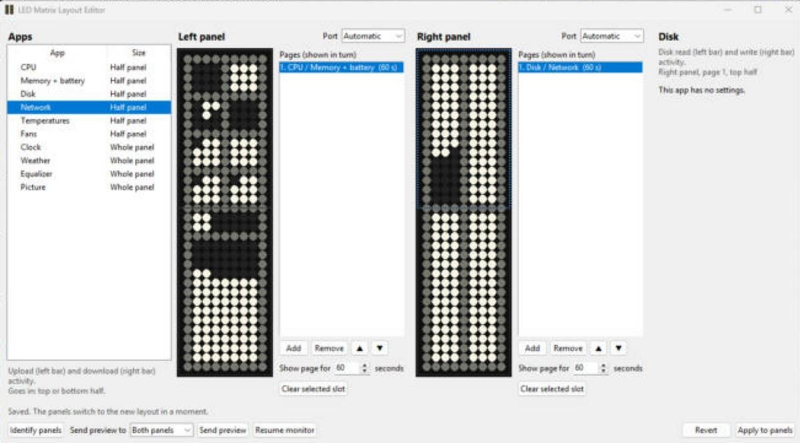
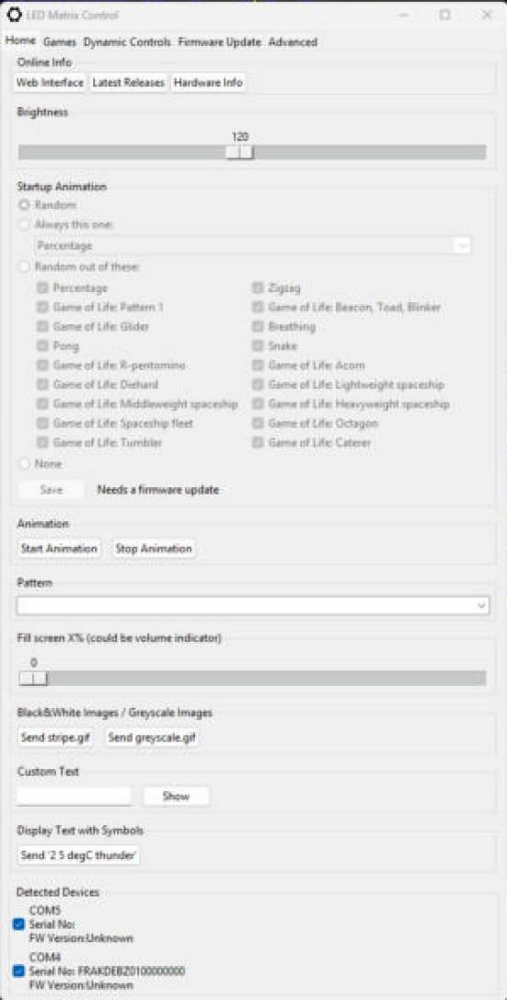
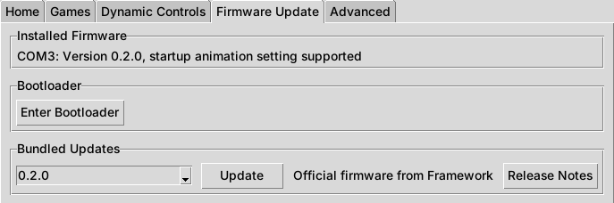

# White Rabbit: Framework 16 LED Matrix app

**One Windows app for everything the Framework Laptop 16 LED Matrix can do.**
It runs in the system tray, turns the LED panels into a system monitor you
design yourself, and also lets you play games and patterns, choose the startup
animation and update the firmware, all from the same window.

> **Status: being built.** This README describes what the app will do. The
> screenshots below come from the two apps it is built from, and will be
> replaced with screenshots of White Rabbit once it exists.

### ⬇ Downloads

Not released yet. When it is, the newest version will be on the
[Releases](https://github.com/kingof9x/white-rabbit-framework-matrix/releases/latest) page:

- `WhiteRabbit-setup.exe`: installer (starts with Windows, Start menu shortcut)
- `WhiteRabbit.exe`: portable app, nothing is installed
- `ledmatrix.uf2`: LED Matrix firmware with the startup animation setting and the extra Game of Life patterns

## Why one app?

Until now there were two separate apps for the LED Matrix:

| | What it does |
|---|---|
| [**led_mon**](https://github.com/kingof9x/led-matrix) | System monitor: CPU, GPU, memory, battery, disk, network, FPS, clock, equalizer and more on the panels, with a tray icon and a layout editor. |
| [**LED Matrix Control** (`ledmatrixgui.exe`)](https://github.com/kingof9x/inputmodule-rs) | Control app: brightness, patterns, games, startup animation, firmware version and firmware updates. |

On Windows only one program at a time can talk to an LED panel. So to change the
startup animation or play a game you had to quit the monitor, open the control
app, then switch back. White Rabbit puts both in one app that owns the panels:
when you start a game or a pattern, the monitor steps aside on that panel and
comes back when you stop it.

## Features

### System monitor (from led_mon)

- Runs in the tray and starts with Windows.
- **Layout editor** with a live preview: drag apps onto the left and right
  panel, top or bottom half, and set up several pages that take turns.
- **Half-panel apps:** CPU cores, CPU graph, GPU graph, memory + battery,
  disk, network, disk + network, temperatures, fans.
- **Whole-panel apps:** clock, weather, music equalizer, FPS counter for
  games, picture.
- Brightness follows the laptop screen, or set it yourself.
- Keyboard shortcuts (`Ctrl`+`Alt`+`Shift` + `I` / `N` / `F` / `U`) to show
  app names, skip to the next app, and freeze or unfreeze app switching.

*The layout editor, from led_mon on Windows.*

*Some of the monitor apps, drawn by the app's own preview code.*

### Control (from LED Matrix Control)

- **Startup animation:** pick one animation to always show, a random one out
  of a set you choose, a random one out of all of them, or none. The choice is
  saved on the module itself, so it works even when the app isn't running.
- **Games and patterns:** Snake, Pong, Breakout, Game of Life with 10 extra
  patterns (R-pentomino, Acorn, spaceships and more), plus the built-in
  patterns and brightness.
- **Firmware:** shows which firmware each panel has, puts a panel into
  bootloader mode, and flashes the bundled firmware (this project's or
  Framework's official one).

| Startup animation | Games |
|---|---|
|  |  |

*From LED Matrix Control. The Home tab screenshot is from Windows; the other two
were taken on Linux with a simulated module.*

*Where each extra Game of Life pattern starts on the 9 x 34 matrix.*

## Testing checklist

Everything here still needs testing on a real Framework Laptop 16 with two LED
Matrix modules on Windows 11. Tick items off (edit this file, or mention them
in an issue) as they are confirmed. Items that were already confirmed in the
original apps are noted, but need checking again in White Rabbit.

**Install and start**
- [ ] The installer installs without an admin prompt and the app starts afterwards
- [ ] The portable `WhiteRabbit.exe` starts and both panels light up
- [ ] The app starts by itself after logging in, and *Start with Windows* turns that on and off
- [ ] Installing a newer version over an old one keeps the settings and the layout
- [ ] Uninstalling from *Settings > Apps* removes the app and the startup entry
- [ ] Starting a second copy only brings the open window forward
- [ ] Settings from an existing led_mon install (layout, brightness) are picked up on first start

**Sharing the panels between monitor and control**
- [ ] Starting a game or pattern pauses the monitor on that panel, *Stop* brings the monitor back
- [ ] Changing the startup animation works while the monitor is running
- [ ] Entering the bootloader / updating firmware stops the monitor first and restarts it afterwards
- [ ] If another program (like the old `ledmatrixgui.exe` or led_mon) holds a panel, the app says so and picks it up once that program closes

**Panels**
- [ ] Left and right panels are detected the right way round; if not, the *Port* boxes fix it
- [ ] Unplugging and plugging back a panel: the app picks it up again
- [ ] Sleep and wake (lid close / open) still work

**Tray menu**
- [ ] Left-click and right-click both open the menu
- [ ] *Brightness* slider and *Follow screen brightness* work
- [ ] *Stop animation* / *Start animation* turn the panels off and on
- [ ] *Open Hardware Monitor*, *Open Framework Control*, *Open log*, *Quit* work; *Quit* turns the panels dark

**Monitor and layout editor**
- [ ] Dragging apps onto panels, pages and settings all work; *Apply to panels* switches straight away
- [ ] *Send preview* and *Resume monitor* work
- [ ] *Ready-made layouts > Classic monitor* fills in both panels
- [ ] CPU cores shows every core; CPU graph and GPU graph move with the load
- [ ] Disk, network and disk + network react to copying files and downloading
- [ ] Memory + battery shows the battery and the charging animation
- [ ] Temperatures and fans show values with `framework_tool.exe`
- [ ] Clock, weather (needs an API key) and equalizer work
- [ ] FPS counter shows a game's frame rate after the one-time *Performance Log Users* setup
- [ ] Keyboard shortcuts work and don't steal `Alt`+`F` from other programs

**Startup animation**
- [ ] *Always this one* plays the chosen animation at every power on (confirmed in LED Matrix Control)
- [ ] *Random out of these* only shows ticked animations over several restarts
- [ ] *Random* still picks different animations
- [ ] *None*: the matrix stays dark until the app uses it
- [ ] The setting survives a full shutdown, not just a restart
- [ ] With Framework's official firmware, the app says the setting isn't supported instead of failing

**Games and patterns**
- [ ] Each game and Game of Life pattern starts, and *Stop* ends it
- [ ] Built-in patterns and the brightness control work

**Firmware**
- [ ] *Installed firmware* shows the right version and whether the startup setting is supported
- [ ] *Enter bootloader* puts the selected panel into bootloader mode (confirmed in LED Matrix Control)
- [ ] Flashing the bundled firmware finds the `RPI-RP2` drive and works on both panels (confirmed in LED Matrix Control)
- [ ] Going back to Framework's official firmware and back again works, and keeps the saved startup setting
- [ ] No flicker while the monitor is running (confirmed with the 0.2.0-based firmware)

## Where it comes from

White Rabbit combines two open source projects, both MIT licensed:

- [kingof9x/led-matrix](https://github.com/kingof9x/led-matrix), a Windows
  fork of [MidnightJava/led-matrix](https://github.com/MidnightJava/led-matrix),
  itself based on [LED System Monitor](https://code.karsttech.com/jeremy/FW_LED_System_Monitor.git).
- [kingof9x/inputmodule-rs](https://github.com/kingof9x/inputmodule-rs), a fork
  of [Framework's inputmodule-rs](https://github.com/FrameworkComputer/inputmodule-rs).
  The LED Matrix firmware itself is still built there.

Thanks to everyone who worked on those.
