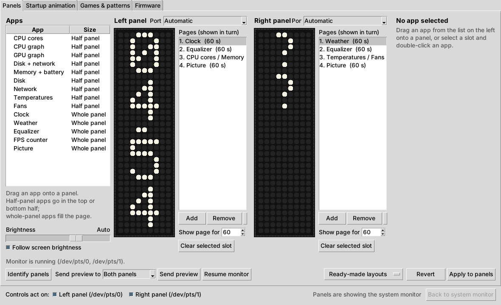
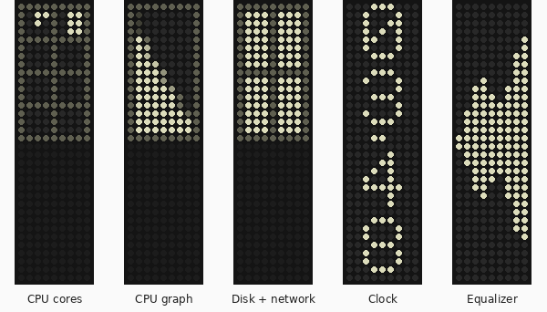
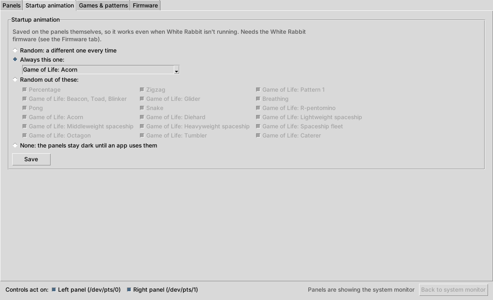
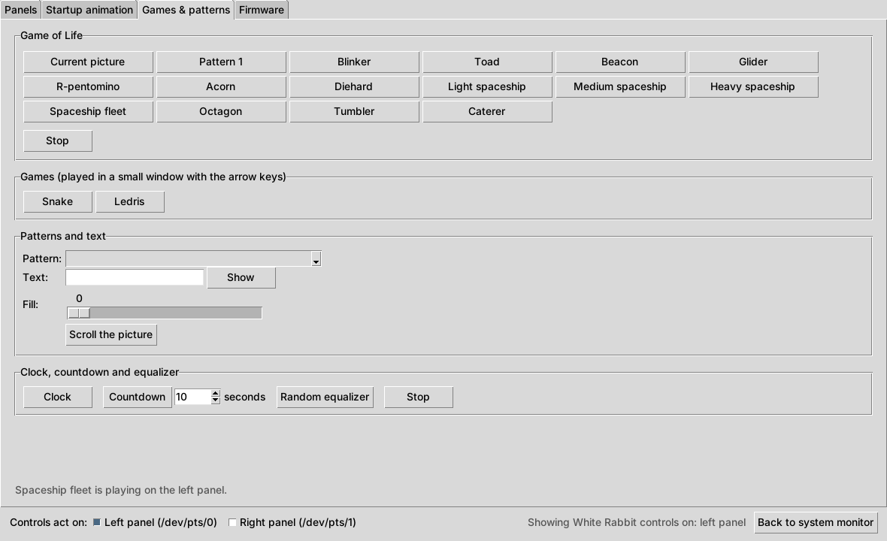
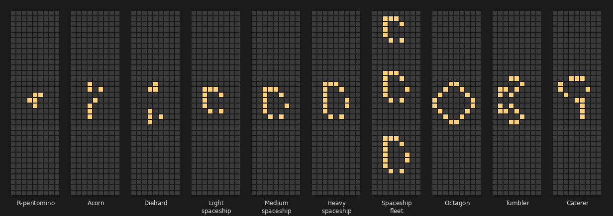
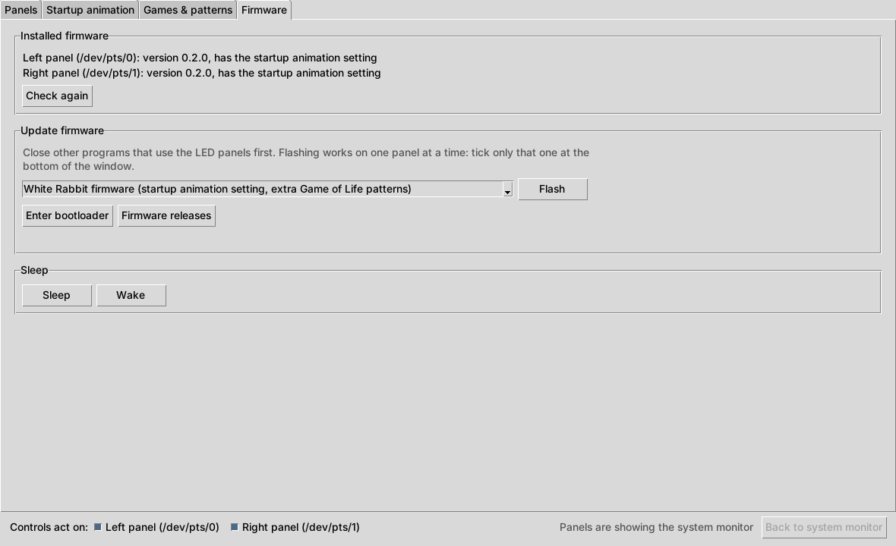

# White Rabbit: Framework 16 LED Matrix app

**One Windows app for everything the Framework Laptop 16 LED Matrix can do.**
It runs in the system tray, turns the LED panels into a system monitor you
design yourself, and lets you play games and patterns, choose the startup
animation and update the firmware, all from the same window.

> **Status: first version, not tested on real hardware yet.** Everything below
> works against simulated panels and passes the automated builds. The testing
> checklist at the bottom tracks what has been confirmed on a real Framework 16.

### ⬇ Downloads

The newest version is on the [Releases](https://github.com/kingof9x/white-rabbit-framework-matrix/releases/latest) page:

- [`WhiteRabbit-setup.exe`](https://github.com/kingof9x/white-rabbit-framework-matrix/releases/latest/download/WhiteRabbit-setup.exe): installer (starts with Windows, Start menu shortcut)
- [`WhiteRabbit.exe`](https://github.com/kingof9x/white-rabbit-framework-matrix/releases/latest/download/WhiteRabbit.exe): portable app, nothing is installed
- [`ledmatrix.uf2`](https://github.com/kingof9x/white-rabbit-framework-matrix/releases/latest/download/ledmatrix.uf2): LED Matrix firmware with the startup animation setting and the extra Game of Life patterns (the app can flash it for you)

These links work once the first release has been published.

## Why one app?

Until now there were two separate apps for the LED Matrix:

| | What it does |
|---|---|
| [**led_mon**](https://github.com/kingof9x/led-matrix) | System monitor: CPU, GPU, memory, battery, disk, network, FPS, clock, equalizer and more on the panels, with a tray icon and a layout editor. |
| [**LED Matrix Control** (`ledmatrixgui.exe`)](https://github.com/kingof9x/inputmodule-rs) | Control app: patterns, games, startup animation, firmware version and firmware updates. |

On Windows only one program at a time can talk to an LED panel, so to change
the startup animation or play a game you had to quit the monitor, open the
control app, then switch back. White Rabbit owns the panels and shares them:
when you start a game or a pattern, the monitor steps aside on that panel only,
and comes back when you press *Stop* or *Back to system monitor*.

## Features

### Panels tab: the system monitor (from led_mon)

- **Layout editor** with a live preview: drag apps onto the left and right
  panel, top or bottom half, and set up several pages that take turns.
- **Half-panel apps:** CPU cores, CPU graph, GPU graph, memory + battery,
  disk, network, disk + network, temperatures, fans.
- **Whole-panel apps:** clock, weather, music equalizer, FPS counter for
  games, picture.
- Brightness follows the laptop screen, or set it yourself.
- Runs in the tray and starts with Windows. Keyboard shortcuts
  (`Ctrl`+`Alt`+`Shift` + `I` / `N` / `F` / `U`) show the app names, skip to
  the next app, and freeze or unfreeze app switching. Each one can be turned
  off on the Keyboard shortcuts tab.





*Some of the monitor apps, drawn by the app's own preview code.*

### Startup animation tab

Pick one animation to always show, a random one out of a set you choose, a
random one out of all of them, or none. The choice is saved on the panel itself,
so it works even when the app isn't running. Needs the White Rabbit firmware.



### Games & patterns tab

Game of Life with 10 extra patterns (R-pentomino, Acorn, spaceships and more),
Snake and Ledris, the firmware's built-in patterns, text, a clock, a countdown
and a random equalizer.





*Where each extra Game of Life pattern starts on the 9 x 34 matrix.*

### Firmware tab

Shows which firmware each panel has, puts a panel into bootloader mode, and
flashes the bundled firmware: White Rabbit's (startup animation setting, extra
patterns) or Framework's official 0.2.0, or any `.uf2` file you choose.



### Keyboard shortcuts tab

Lists the monitor's keyboard shortcuts and what each one does, with a
checkbox to turn each shortcut on or off. A shortcut that's off is left free
for other programs, and the change works straight away without restarting.

*Screenshots taken on Linux with simulated panels, so the window looks a little
different from Windows.*

## Install and use

1. Download [`WhiteRabbit-setup.exe`](https://github.com/kingof9x/white-rabbit-framework-matrix/releases/latest/download/WhiteRabbit-setup.exe)
   (or the portable `WhiteRabbit.exe`) and run it. If Windows shows *"Windows
   protected your PC"*, click *More info* > *Run anyway* (the app isn't code-signed).
2. Quit the old apps first if you use them: led_mon (tray icon > *Quit*) and
   `ledmatrixgui.exe`. They would be holding the panels.
3. The panels show the system monitor, an LED icon appears in the tray, and
   the White Rabbit window opens. Opening the app again from the Start menu,
   or *Open White Rabbit...* in the tray menu, brings the window back.
4. **Coming from led_mon?** Your layout, brightness and weather API key are
   copied from `%APPDATA%\led_mon` the first time White Rabbit starts.
5. The checkboxes at the bottom of the window choose which panels the
   Startup animation, Games & patterns and Firmware controls act on. *Back to
   system monitor* hands borrowed panels back to the monitor.
6. **Firmware:** the startup animation and the extra patterns need the White
   Rabbit firmware. On the Firmware tab, tick one panel, pick *White Rabbit
   firmware*, click *Flash*, then do the same for the other panel.

Something not working? Right-click the tray icon > *Open log*, or run
`WhiteRabbit.exe --diagnose` in a command prompt to see which panels the app finds.

### Good to know

- **Temperatures and fans** use Framework's `framework_tool.exe`: download it
  from the [framework-system releases](https://github.com/FrameworkComputer/framework-system/releases)
  and put it next to `WhiteRabbit.exe` (installed app: `%LOCALAPPDATA%\Programs\WhiteRabbit`).
- **FPS counter** uses Intel's PresentMon, which the installer includes. Windows
  only lets programs read frame timing when the account is in the *Performance
  Log Users* group. One-time setup in *Terminal (Admin)*:
  `Add-LocalGroupMember -SID S-1-5-32-559 -Member "$env:USERDOMAIN\$env:USERNAME"`,
  then sign out and back in.
- **Open Hardware Monitor** (or Libre Hardware Monitor) has no installer, so the
  tray looks anywhere in your Desktop, Downloads and Documents (three folders
  deep), in Program Files, `C:\`, and next to `WhiteRabbit.exe`. If it isn't in any of those, the tray item says *Find Open
  Hardware Monitor...*: click it and pick `OpenHardwareMonitor.exe` once, and it
  is remembered. It asks for admin rights each time it starts (that's normal for it).
- **Weather** needs an API key in `%APPDATA%\WhiteRabbit\.env` (see [`.env-example`](.env-example)).
- **Where things live:** settings and layout in `%APPDATA%\WhiteRabbit`, the
  log in `%LOCALAPPDATA%\WhiteRabbit\WhiteRabbit.log`.
- **Command line:** `WhiteRabbit.exe --background` starts only the monitor and
  tray icon (that's what runs at login); `--window` only the window;
  `--window --tab firmware` opens it on a tab.

## Testing checklist

Tested on a real Framework Laptop 16 with two LED Matrix modules on Windows 11.
Ticked items are confirmed (kept in step with Callum's Project Workbench). Tick items off (edit this file, or mention them
in an issue) as they are confirmed. Items marked *(confirmed in the old app)*
worked in led_mon or LED Matrix Control, but need checking again here.

**Install and start**
- [ ] The installer installs without an admin prompt, and the panels and the window come up afterwards
- [x] The portable `WhiteRabbit.exe` starts and both panels light up
- [ ] After logging in, only the tray icon starts (no window), and *Start with Windows* in the tray turns that on and off
- [x] Opening the app again, or the tray's *Open White Rabbit...*, shows the window (only one window at a time)
- [ ] Installing a newer version over an old one keeps the settings and the layout
- [ ] Uninstalling from *Settings > Apps* removes the app and the startup entry
- [x] An existing led_mon layout, brightness and `.env` are picked up on the first start

**Sharing the panels between monitor and controls**
- [x] Starting a Game of Life pattern borrows only the ticked panel; the other keeps showing the monitor
- [x] *Stop* and *Back to system monitor* bring the monitor back, at the right brightness
- [x] Saving the startup animation plays it once, then the monitor comes back by itself after about 10 seconds
- [x] Closing the window while a game runs gives the panel back to the monitor
- [x] With the tray app quit, the window's controls still work on their own
- [ ] If another program (like the old `ledmatrixgui.exe` or led_mon) holds a panel, the Firmware tab says so

**Panels**
- [x] Left and right panels are detected the right way round; if not, the *Port* boxes on the Panels tab fix it
- [x] Unplugging and plugging back a panel: the app picks it up again
- [ ] Sleep and wake (lid close / open) still work

**Tray menu**
- [x] Left-click and right-click both open the menu
- [x] *Brightness* slider and *Follow screen brightness* work
- [x] *Stop animation* / *Start animation* turn the panels off and on
- [x] *Open Hardware Monitor*, *Open Framework Control*, *Open log*, *Quit* work; *Quit* turns the panels dark
- [ ] *Open Hardware Monitor* finds `OpenHardwareMonitor_x64.exe` in a folder on the Desktop
- [ ] When it isn't found, *Find Open Hardware Monitor...* opens a normal Windows file window, remembers the choice and opens it

**Panels tab (layout editor)**
- [ ] Dragging apps onto panels, pages and settings all work; *Apply to panels* switches straight away *(confirmed in the old app)*
- [ ] *Send preview* and *Resume monitor* work
- [ ] *Ready-made layouts > Classic monitor* fills in both panels
- [ ] Closing the window with unsaved layout changes asks whether to apply them

**Monitor apps**
- [x] CPU cores shows every core; CPU graph and GPU graph move with the load
- [x] Disk, network and disk + network react to copying files and downloading
- [x] Memory + battery shows the battery and the charging animation
- [ ] Temperatures and fans show values with `framework_tool.exe`
- [ ] Clock, weather (needs an API key) and equalizer work
- [ ] FPS counter shows a game's frame rate after the one-time *Performance Log Users* setup
- [ ] Keyboard shortcuts work and don't steal `Alt`+`F` from other programs

**Startup animation tab**
- [x] *Always this one* plays the chosen animation at every power on *(confirmed in the old app)*
- [ ] *Random out of these* only shows ticked animations over several restarts
- [ ] *Random* still picks different animations
- [ ] *None*: the panels stay dark until the app uses them
- [ ] The setting survives a full shutdown, not just a restart
- [ ] With Framework's official firmware, the tab says the setting needs the White Rabbit firmware

**Games & patterns tab**
- [x] Each Game of Life pattern starts, and *Stop* ends it
- [ ] Patterns 2 to 5 run on the panels (needs firmware with them)
- [x] Snake and Ledris open their small window and play on the panels
- [ ] Patterns, text, fill, clock, countdown and random equalizer work

**Keyboard shortcuts tab**
- [ ] All four shortcuts are listed with `Ctrl`+`Alt`+`Shift` keys
- [ ] Unticking a shortcut stops it working straight away; ticking it again brings it back
- [ ] The choice is remembered after quitting and starting White Rabbit again

**Firmware tab**
- [x] *Installed firmware* shows the right version and whether the startup setting is there
- [x] *Enter bootloader* puts the ticked panel into bootloader mode *(confirmed in the old app)*
- [x] *Flash* with the White Rabbit firmware works on each panel, and the monitor comes back afterwards
- [x] *Flash* with a `.uf2` file you choose works *(confirmed 2026-10-28 with the Patterns 2 to 5 test firmware)*
- [ ] The bundled White Rabbit firmware includes Patterns 2 to 5 (builds made after 2026-10-28 06:00 UTC)
- [ ] Flashing Framework's official firmware and back again works, and keeps the saved startup setting
- [x] No flicker while the monitor is running *(confirmed with the 0.2.0-based firmware)*

## Making a release

In GitHub go to *Actions > Windows build > Run workflow*, type a version such
as `1.0.0`, and run it. When it finishes, the release `v1.0.0` appears on the
Releases page with `WhiteRabbit-setup.exe`, `WhiteRabbit.exe` and
`ledmatrix.uf2` attached. Leaving the version empty makes a test build (the
files are under the run's *Artifacts*) without a release.

The firmware is built in [kingof9x/inputmodule-rs](https://github.com/kingof9x/inputmodule-rs):
each White Rabbit build bundles the newest firmware from its Releases page.

## Run or build it yourself

Windows, Python 3.12:

```powershell
git clone https://github.com/kingof9x/white-rabbit-framework-matrix
cd white-rabbit-framework-matrix
py -3.12 -m venv .venv
.venv\Scripts\activate
python -m pip install -r requirements.txt pytest
python -m pytest
python main.py                    # monitor + tray + window
python main.py --window           # just the window
python -m PyInstaller white_rabbit.spec --noconfirm    # dist\WhiteRabbit\WhiteRabbit.exe
```

On Linux the monitor runs in the console as before (`python main.py`), and
`python main.py --window` opens the window next to it.

## Where it comes from

White Rabbit combines two open source projects, both MIT licensed (see
[LICENSE](LICENSE) and [LICENSES/](LICENSES)):

- [kingof9x/led-matrix](https://github.com/kingof9x/led-matrix), a Windows
  fork of [MidnightJava/led-matrix](https://github.com/MidnightJava/led-matrix),
  itself based on [LED System Monitor](https://code.karsttech.com/jeremy/FW_LED_System_Monitor.git).
  It is the `led_mon` folder here.
- [kingof9x/inputmodule-rs](https://github.com/kingof9x/inputmodule-rs), a fork
  of [Framework's inputmodule-rs](https://github.com/FrameworkComputer/inputmodule-rs).
  Its Python package is the `inputmodule` folder here; the LED Matrix firmware
  itself is still built there.

Thanks to everyone who worked on those.

## Project status

**Status:** Waiting on Callum  
**Waiting on:** Callum: run the testing checklist, and merge PR #1 (Game of Life Patterns 2 to 5)  
**Notes:** One tray app combining led_mon and the LED Matrix controls. Not released yet. Newest additions: Keyboard shortcuts tab, Open Hardware Monitor finder fixes.  
**Last updated:** 2026-10-28

