# White Rabbit: Framework 16 LED Matrix app

**One Windows app for everything the Framework Laptop 16 LED Matrix can do.**
It runs in the system tray, turns the LED panels into a system monitor you
design yourself, and lets you play games and patterns, choose the startup
animation and update the firmware, all from the same window.

### ⬇ Downloads

The newest version is on the [Releases](https://github.com/kingof9x/white-rabbit-framework-matrix/releases/latest) page:

- [`WhiteRabbit-setup.exe`](https://github.com/kingof9x/white-rabbit-framework-matrix/releases/latest/download/WhiteRabbit-setup.exe): installer (starts with Windows, Start menu shortcut)
- [`WhiteRabbit.exe`](https://github.com/kingof9x/white-rabbit-framework-matrix/releases/latest/download/WhiteRabbit.exe): portable app, nothing is installed
- [`ledmatrix.uf2`](https://github.com/kingof9x/white-rabbit-framework-matrix/releases/latest/download/ledmatrix.uf2): LED Matrix firmware with the startup animation setting and the extra Game of Life patterns (the app can flash it for you)

<!-- virus-scan:start -->
<!-- virus-scan:end -->

## Why one app?

Until now there were two separate apps for the LED Matrix:

| | What it does |
|---|---|
| [**led_mon**](https://github.com/kingof9x/led-matrix) | System monitor: CPU, GPU, memory, battery, disk, network, FPS, clock, equalizer and more on the panels, with a tray icon and a layout editor. |
| [**LED Matrix Control** (`ledmatrixgui.exe`)](https://github.com/kingof9x/inputmodule-rs) | Control app: patterns, games, startup animation, firmware version and firmware updates. |

On Windows only one program at a time can talk to an LED panel, so to change
the startup animation or play a game you had to quit the monitor, open the
control app, then switch back. White Rabbit owns the panels and shares them:
when you start a game or a pattern, the monitor steps aside on that panel only,
and comes back when you press *Stop* or *Back to system monitor*.

## Features

### Panels tab: the system monitor (from led_mon)

- **Layout editor** with a live preview: drag apps onto the left and right
  panel, top or bottom half, and set up several pages that take turns.
- **Half-panel apps:** CPU cores (with an afterglow: a dim trail where each
  core's load just was), CPU graph, GPU graph, memory + battery, battery as a
  pile of sand (charging rains sand in, on battery it drains away), disk,
  network, disk + network, temperatures, fans, FPS number.
- **Whole-panel apps:** clock, weather, audio visualizer, now playing (the
  cover of whatever is playing, the song name scrolling along the top and a
  small visualizer, across both panels), FPS counter for games, picture, text.
- **Text app:** type your own words, with `{time}`, `{battery}` and `{cpu}`
  filled in live. Three styles: *ticker* (upright letters scrolling up),
  *sideways* (reads along the panel with your head tilted right) and
  *stacked* (two letters per row, words split by a dotted line).
- Brightness follows the laptop screen, or set it yourself.
- The panels turn off when you close the lid, when the screen turns off, or
  when the laptop goes to sleep, and come back when you open it. Turn this
  off with *Turn off when lid closes* in the tray menu.
- The panels also turn off when the laptop's own screen isn't in use: docked
  with the lid shut, or Windows set to *Second screen only* (`Win`+`P`). Turn
  this off with *Turn off when laptop screen isn't used* in the tray menu or
  under the brightness slider in the Panels tab.
- Runs in the tray and starts with Windows. Keyboard shortcuts
  (`Ctrl`+`Alt`+`Shift` + `I` / `N` / `F` / `U` / `M`) show the app names, skip to
  the next app, freeze or unfreeze app switching, and turn music mode on or
  off. Each one can be turned off on the Keyboard shortcuts tab.

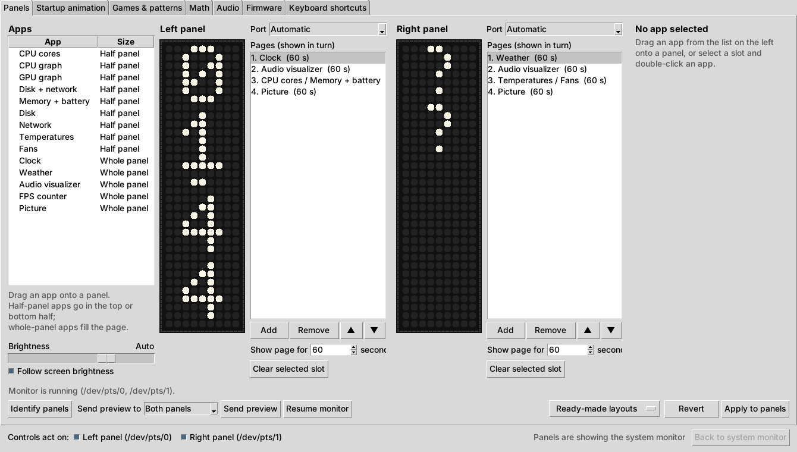

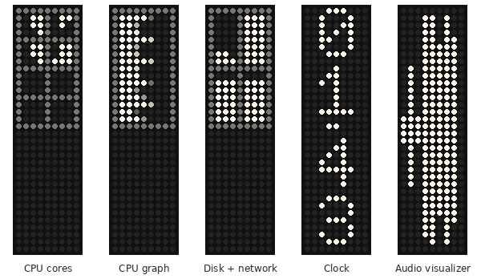

*Some of the monitor apps, drawn by the app's own preview code.*

### Startup animation tab

Pick one animation to always show, a random one out of a set you choose, a
random one out of all of them, or none. The choice is saved on the panel itself,
so it works even when the app isn't running. Needs the White Rabbit firmware.

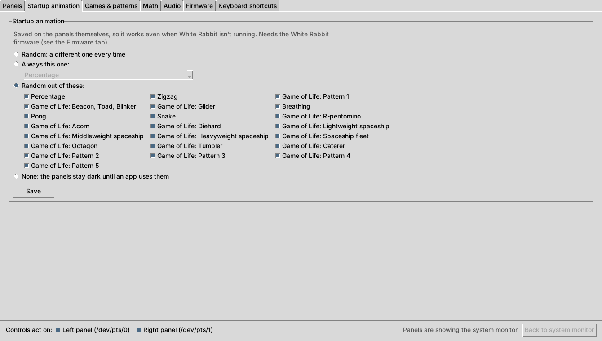

### Games & patterns tab

Four games played right on the panels: **Snake**, **Ledris**, **Breakout** and
**Rabbit run** (dodge the falling rocks, catch the carrots). With both panels
ticked a game uses them as one 18 x 34 screen; Ledris puts the next piece, the
score and the level on the right panel. Play with the arrow keys (space to
drop, launch or play again) while the game's preview in the window has the
keyboard; Esc or P pauses, and the game pauses by itself if you click away.
A 3-2-1 starts each game, the score shows on the panels at the end, and the best
score for each game is kept.

Also on this tab: Game of Life with 10 extra patterns (R-pentomino, Acorn,
spaceships and more), the firmware's built-in patterns, text, a clock, a
countdown and a random equalizer.

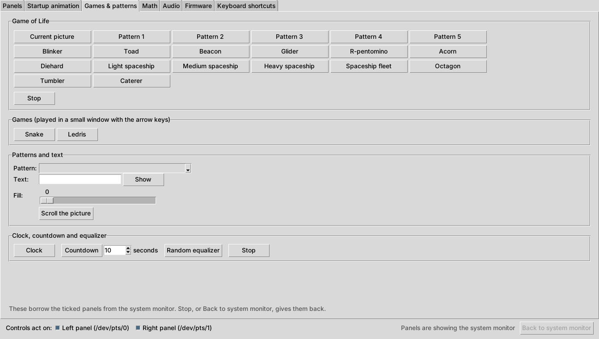

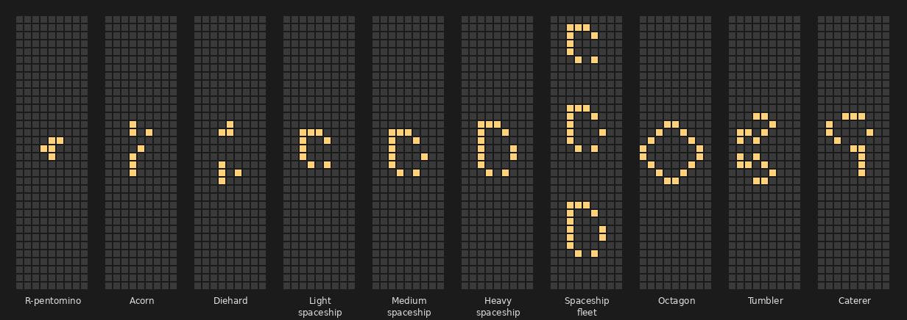

*Where each extra Game of Life pattern starts on the 9 x 34 matrix.*

### Audio tab

An audio visualizer that moves with what the laptop is playing, or with what a
microphone hears (pick any microphone Windows has).

- **Music mode** shows the visualizer on both panels until you turn it off.
  Turn it on here, with *Music mode* in the tray menu, or with
  `Ctrl`+`Alt`+`Shift`+`M`. It uses the look last picked on this tab.
- **22 looks:** classic, spectrum analyzer, centre out, dots, spectrogram,
  level meter, waveform, mirror waveform, double waveform, radial bars,
  radial fan, radial facing, rings, pulse, sparkle, bonfire, beat tunnel,
  fountain, lava lamp, heartbeat, dancing rabbit, and water, glow and sparks
  (the bass pushes ripples through water, the middle notes glow, the treble
  throws sparks). On the radial looks and
  most of the newer ones the left panel is a mirror image of the right one.
- **Options:** one 18-bar spectrum across both panels, peak dots, shading,
  upside down, falling speed, sensitivity, and automatic sensitivity.
- A live preview of both panels and a sound check, which show whether the
  microphone (or the music) is being heard.

The same looks and options are on the *Audio visualizer* app in the layout
editor, so it can also take turns with the other apps.

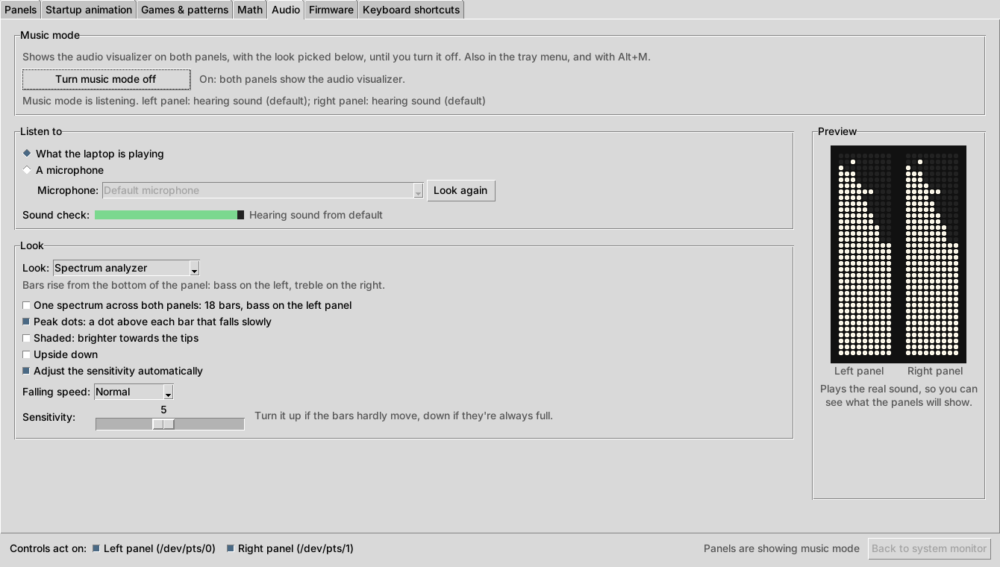

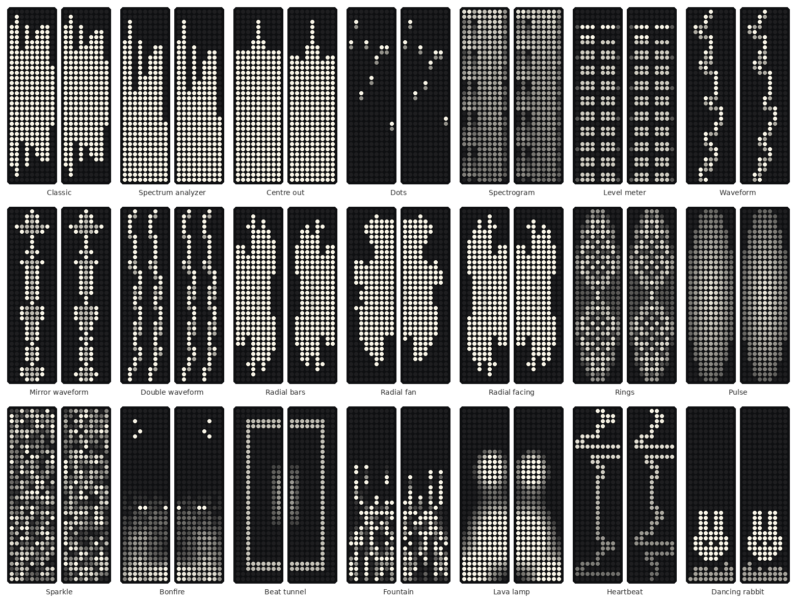

*21 of the looks playing the same moment of music, drawn by the app's own
visualizer code (the water look is newer than this picture).*

### Effects tab

Little extras that play over whatever the panels show.

- **Plug-in ripple:** plug in the charger, headphones or any USB device and a
  ripple runs across the panel from that port's side. Unplug it and the
  picture drains out through the port. *Try it* buttons show it without
  plugging anything in, and if White Rabbit guesses the wrong port you can
  tell it the right one; it remembers.
- **Text line:** a line of small letters scrolls across the top of both
  panels when a new song starts, the charger goes in or out, or the battery is
  low, or with your own message.
- **Changing apps:** slide the next app in from the bottom, or cut straight to
  it.
- **Keep every shade when dim:** dark pictures keep their detail at low
  brightness. Needs the newest White Rabbit firmware.

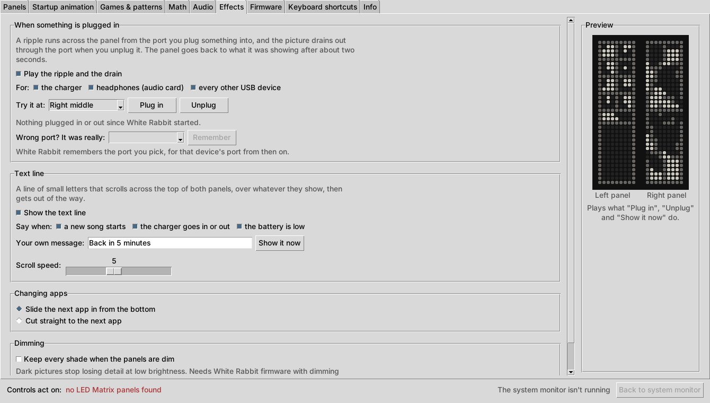

### Math tab

Graphs and simulations drawn in greyscale on the panels. With both panels
ticked they work as one 18 x 34 picture. A preview on the right shows the same
thing, even with no panels connected.

- **Graphs**: 20 ready-made ones (sine, tangent, bell curve, damped wave...),
  *Random graphs* to cycle through them, or type your own formula such as
  `sin(x) * x`. Put `t` in a formula to make it move, like `sin(x - t)`.
- **Game of Life and other Life-like rules**: Conway's Life, HighLife, Seeds,
  Day & Night, Maze and more, or type your own birth/survival numbers. Start
  from random cells, a math graph, or a classic pattern. It starts over when
  it dies out or settles.
- **Traffic jam** (Biham-Middleton-Levine model): two kinds of cars taking
  turns. Busy roads jam for good.
- **Gas particles** (Hardy-Pomeau-Pazzis lattice gas): particles bouncing off
  each other and the walls, starting at random, packed in a corner, or along a
  math graph.
- **One-line automata**: elementary rules like Rule 30 and Rule 90, and
  3-colour totalistic codes like 777, scrolling up one generation per row.
- **More maths**: Langton's Ant, Collatz sequences, the prime sieve and Ulam
  spiral, the Lorenz attractor, a double pendulum, bubble/quick/merge sort,
  building and solving a maze, Fourier circles drawing the White Rabbit,
  random-walk frost, digits of pi and e, and Lissajous curves. Each one sets
  the speed it looks best at when you start it.
- **Random grey noise**, and a speed slider for all of them.
- **Both panels** (under the preview): *Side by side* (the panels act as if
  they touched), *Side by side, skip the keyboard* (the picture carries on
  behind the keyboard so moving things line up across it; the gap is set in
  LED columns, with a gap test to help), or *Mirror* (the left panel shows the
  right one mirrored).

**Name panels...** at the bottom of the window gives the left and right panels
names. Identify panels (Panels tab or tray menu) then shows the first five
letters of each name on the panel for two seconds before the app names.

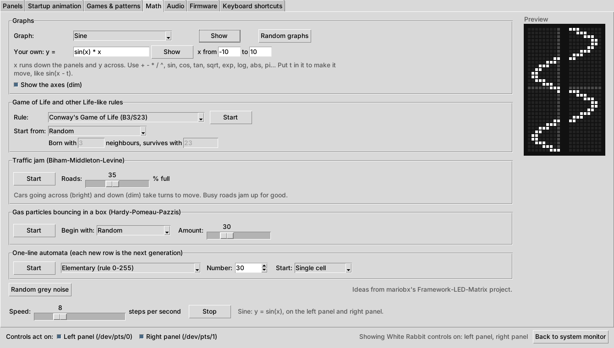

### Firmware tab

Shows which firmware each panel has, puts a panel into bootloader mode, and
flashes the bundled firmware: White Rabbit's (startup animation setting, extra
patterns, dimming that keeps every shade) or Framework's official 0.2.0, or any `.uf2` file you choose.

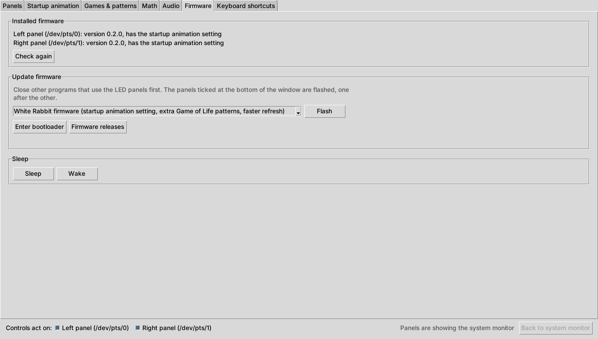

### Keyboard shortcuts tab

Lists the monitor's keyboard shortcuts and what each one does, with a
checkbox to turn each shortcut on or off. A shortcut that's off is left free
for other programs, and the change works straight away without restarting.

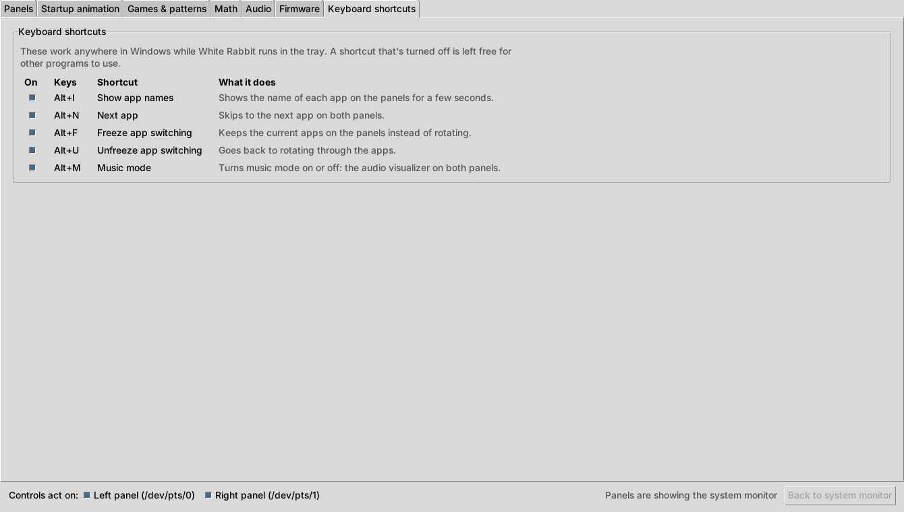

*Screenshots taken on Linux with simulated panels, so the window looks a little
different from Windows (the shortcuts show as `Alt` + key there instead of
`Ctrl`+`Alt`+`Shift` + key).*

## Install and use

1. Download [`WhiteRabbit-setup.exe`](https://github.com/kingof9x/white-rabbit-framework-matrix/releases/latest/download/WhiteRabbit-setup.exe)
   (or the portable `WhiteRabbit.exe`) and run it. If Windows shows *"Windows
   protected your PC"*, click *More info* > *Run anyway* (the app isn't code-signed).
2. Quit the old apps first if you use them: led_mon (tray icon > *Quit*) and
   `ledmatrixgui.exe`. They would be holding the panels.
3. The panels show the system monitor, an LED icon appears in the tray, and
   the White Rabbit window opens. Opening the app again from the Start menu,
   or *Open White Rabbit...* in the tray menu, brings the window back.
   To keep the tray icon out of the hidden-icons arrow, turn on *White Rabbit* in
   *Settings > Personalization > Taskbar > Other system tray icons* (Windows 11),
   or drag the icon from the arrow onto the taskbar.
4. **Coming from led_mon?** Your layout, brightness and weather API key are
   copied from `%APPDATA%\led_mon` the first time White Rabbit starts.
5. The checkboxes at the bottom of the window choose which panels the
   Startup animation, Games & patterns and Firmware controls act on. *Back to
   system monitor* hands borrowed panels back to the monitor.
6. **Firmware:** the startup animation and the extra patterns need the White
   Rabbit firmware. On the Firmware tab, tick one panel, pick *White Rabbit
   firmware*, click *Flash*, then do the same for the other panel.

Something not working? Right-click the tray icon > *Open log*, or run
`WhiteRabbit.exe --diagnose` in a command prompt to see which panels the app finds.

### Good to know

- **Temperatures and fans**: on the Panels tab, click the Temperatures or Fans app on a panel. Its
  settings (on the right) choose which sensor each of the three numbers shows and Celsius or Fahrenheit,
  plus, for all panels, where readings come from (*Read from*, saved as `sensor_source` in `settings.json`)
  and how often (*Read every*, `sensor_refresh_seconds`):
  - *Automatic* (default): tries each of the ones below in that order and uses the first that gives readings.
  - *[Framework Control](https://github.com/ozturkkl/framework-control)*: its service reads them with
    system rights, so nothing has to be open and White Rabbit needs no admin prompt. On a Framework 16
    it gives the CPU, APU, ambient and charger temperatures and both fans.
  - *[Libre Hardware Monitor](https://github.com/LibreHardwareMonitor/LibreHardwareMonitor/releases)*:
    White Rabbit reads its sensors through Windows (WMI) while it is open and running as admin.
    Which sensors show depends on the laptop.
  - *framework_tool*: Framework's `framework_tool.exe`
    ([framework-system releases](https://github.com/FrameworkComputer/framework-system/releases)), next to
    `WhiteRabbit.exe` or on PATH. Only works when White Rabbit itself runs as admin.

  The Panels tab shows which source the readings come from right now, and `WhiteRabbit.exe --diagnose`
  lists what each source gives.
- **FPS counter** uses Intel's PresentMon, which the installer includes. Windows
  only lets programs read frame timing when the account is in the *Performance
  Log Users* group. One-time setup in *Terminal (Admin)*:
  `Add-LocalGroupMember -SID S-1-5-32-559 -Member "$env:USERDOMAIN\$env:USERNAME"`,
  then sign out and back in.
  In the FPS counter's settings, *Game to watch* starts on *Automatic*: it shows the
  full-screen game in front and keeps showing it while you switch to other windows. To
  watch one game all the time, open the list and pick it by its window title; apps
  drawing frames right now are at the top with their FPS.
  The full-panel *FPS counter* shows the number on the top half and a histogram below
  it that scrolls left, one column per second (the last 9 seconds). The half-panel
  *FPS number* shows just the number. Both count the frames an app puts on screen, so an app with its own counter (such as
  Resolume) can show a different number, and a covered window that stops drawing shows 0.
- **[Libre Hardware Monitor](https://github.com/LibreHardwareMonitor/LibreHardwareMonitor/releases)** has no installer, so the
  tray looks anywhere in your Desktop, Downloads and Documents (three folders
  deep), in Program Files, `C:\`, and next to `WhiteRabbit.exe`. If it isn't in any of those, the tray item says *Find Libre
  Hardware Monitor...*: click it and pick `LibreHardwareMonitor.exe` once, and it
  is remembered. It asks for admin rights each time it starts (that's normal for it).
  The old Open Hardware Monitor isn't supported: it unpacks the WinRing0 driver, which
  has a known security hole, and Windows Defender blocks it and can flag apps that start it.
- **Weather** needs an API key in `%APPDATA%\WhiteRabbit\.env` (see [`.env-example`](.env-example)).
- **Where things live:** settings and layout in `%APPDATA%\WhiteRabbit`, the
  log in `%LOCALAPPDATA%\WhiteRabbit\WhiteRabbit.log`.
- **Command line:** `WhiteRabbit.exe --background` starts only the monitor and
  tray icon (that's what runs at login); `--window` only the window;
  `--window --tab firmware` opens it on a tab.

### Virus scan

After a release, go to *Actions > Virus scan > Run workflow* (leave the box
empty for the newest release) and run it. It uploads `WhiteRabbit-setup.exe`
and `WhiteRabbit.exe` to [VirusTotal](https://www.virustotal.com), waits for
the results (a few minutes) and puts them in a *Virus scan* section near the
top of this README. It needs a free VirusTotal API key saved as the repository secret
`VIRUSTOTAL_API_KEY` (*Settings > Secrets and variables > Actions*).

The firmware is built in [kingof9x/inputmodule-rs](https://github.com/kingof9x/inputmodule-rs):
each White Rabbit build bundles the newest firmware from its Releases page.

## Run or build it yourself

Windows, Python 3.12:

```powershell
git clone https://github.com/kingof9x/white-rabbit-framework-matrix
cd white-rabbit-framework-matrix
py -3.12 -m venv .venv
.venv\Scripts\activate
python -m pip install -r requirements.txt pytest
python -m pytest
python main.py                    # monitor + tray + window
python main.py --window           # just the window
python -m PyInstaller white_rabbit.spec --noconfirm    # dist\WhiteRabbit\WhiteRabbit.exe
```

On Linux the monitor runs in the console as before (`python main.py`), and
`python main.py --window` opens the window next to it.

## Where it comes from

White Rabbit combines two open source projects, both MIT licensed (see
[LICENSE](LICENSE) and [LICENSES/](LICENSES)):

- [kingof9x/led-matrix](https://github.com/kingof9x/led-matrix), a Windows
  fork of [MidnightJava/led-matrix](https://github.com/MidnightJava/led-matrix),
  itself based on [LED System Monitor](https://code.karsttech.com/jeremy/FW_LED_System_Monitor.git).
  It is the `led_mon` folder here.
- [kingof9x/inputmodule-rs](https://github.com/kingof9x/inputmodule-rs), a fork
  of [Framework's inputmodule-rs](https://github.com/FrameworkComputer/inputmodule-rs).
  Its Python package is the `inputmodule` folder here; the LED Matrix firmware
  itself is still built there.

Thanks to everyone who worked on those.

The plug-in ripple, the sand battery, the now playing app, the CPU afterglow,
the text line, the sliding between apps, the water look and dimming by LED
current were inspired by patate's (slowpaste)
[pixeled](https://github.com/slowpaste/pixeled). They are written from scratch
for White Rabbit; no code was copied.

Most of the Math tab's graphs and simulations come from mariobx's
[Framework-LED-Matrix](https://github.com/mariobx/Framework-LED-Matrix). That
project is GPL-3.0 licensed, so no code was copied: the Math tab is written
from scratch from the textbook definitions of each graph and simulation. The
"More maths" effects are classic math demos, also written from scratch.

The mirror, keyboard gap and panel name ideas come from Deovandski's
[Framework16 LED Matrix Manager](https://github.com/Deovandski/Deo-s-Framework16-LED-Matrix-Manager)
(MIT). Only the ideas were used; the code here is written separately.

## Project status

**Status:** Active  
**Waiting on:** Developer: run the testing checklist  
**Notes:** One tray app combining led_mon and the LED Matrix controls. Not released yet. Newest additions: Keyboard shortcuts tab, Open Hardware Monitor finder fixes.  
**Last updated:** 2026-11-09

