# White Rabbit - Framework 16 LED Control

**One Windows app for the Framework Laptop 16's lights: the LED Matrix panels
and the RGB keyboard and macropad.** It runs in the system tray, turns the LED
panels into a system monitor you lay out yourself, plays games, math art and an
audio visualizer on them, sets the startup animation and updates the firmware.
It also lights, maps and updates the RGB keyboard and macropad. Everything is in
one window that looks like the Windows 11 Settings app, and the whole app is
written in Rust.

[Website](https://kingof9x.github.io/white-rabbit-framework-matrix/) ·
[Releases](https://github.com/kingof9x/white-rabbit-framework-matrix/releases/latest) ·
[Forum thread](https://community.frame.work/t/led-matrix-windows-app-white-rabbit/85889) ·
[How it works (for reviewers)](docs/ARCHITECTURE.md)

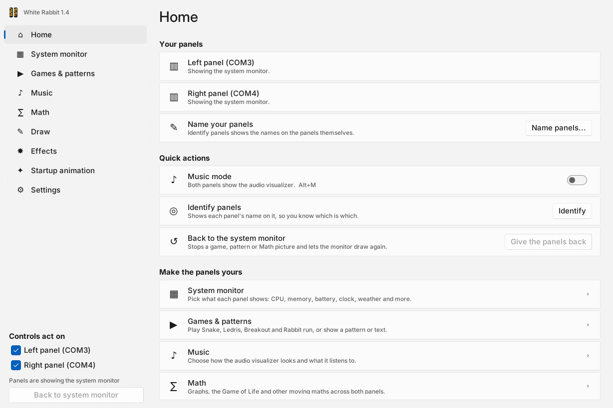

### ⬇ Downloads

The newest version is on the [Releases](https://github.com/kingof9x/white-rabbit-framework-matrix/releases/latest) page:

- [`WhiteRabbit-setup.exe`](https://github.com/kingof9x/white-rabbit-framework-matrix/releases/latest/download/WhiteRabbit-setup.exe): installer (starts with Windows, Start menu shortcut)
- [`WhiteRabbit-portable.zip`](https://github.com/kingof9x/white-rabbit-framework-matrix/releases/latest/download/WhiteRabbit-portable.zip): portable app, nothing is installed. Unzip it anywhere and run `WhiteRabbit.exe`
- [`ledmatrix.uf2`](https://github.com/kingof9x/white-rabbit-framework-matrix/releases/latest/download/ledmatrix.uf2): LED Matrix firmware with the startup animation setting and the extra Game of Life patterns (the app can flash it for you)

Windows 10 or 11 on a Framework Laptop 16. The app is free and open source (MIT).

<!-- virus-scan:start -->
<!-- virus-scan:end -->

## Contents

- [Memory use](#memory-use)
- [What's new](#whats-new)
- [Features](#features)
- [Install and use](#install-and-use)
- [Good to know](#good-to-know)
- [For reviewers and developers](#for-reviewers-and-developers)
- [Where it comes from](#where-it-comes-from)
- [Project status](#project-status)

## Memory use

The part of White Rabbit that is always running (the system monitor and tray
icon, `WhiteRabbit.exe`) used to be a Python program packed with PyInstaller.
It is now Rust.

| Version | Memory in Task Manager (always-running part) |
|---|---|
| Python (up to 1.3) | about **66 MB** (65.6 MB, plus a 0.6 MB launcher process) |
| First Rust version (1.4) | about **8 MB** |
| Rust, today (1.6) | about **6 MB** |

That is roughly **11 times less** than the Python version. Measured in Windows
Task Manager (*Details* tab, *Memory* column, which is the private working set)
on a Framework Laptop 16 with the settings window closed. These are single
readings on one laptop, not a benchmark. The settings window
(`WhiteRabbitWindow.exe`) is a separate program that only runs while it is open,
so it isn't in these numbers. How the numbers were taken and what else was
checked is in [REVIEW.md](REVIEW.md).

No Python is shipped at all any more, so there is no PyInstaller wrapper, which
is what some antivirus programs used to flag.

## What's new

### Not released yet (on `main` since 1.6)

- **Audio reactivity at the top of Home:** one switch for the LED panels and one
  for the keyboard, each with its own sound source (what the laptop is playing,
  or any microphone).
- **Battery app:** the battery now reaches the panel's last row.

### 1.6: the keyboard joins, and a new system monitor

- **The Framework 16 Keyboard Control app is now part of White Rabbit**, and the
  app is called *White Rabbit - Framework 16 LED Control*. The *Keyboard &
  macropad* pages (Lighting, Audio show, Key mapping, Macropad) show up when an
  RGB keyboard or macropad is plugged in ([more](#keyboard--macropad-pages)).
  Settings from the old app are copied over the first time, and the installer
  offers to remove the old app.
- **Your hardware on Home:** the LED panels, keyboard and macropad that White
  Rabbit found, drawn on a picture of the laptop, with what each panel shows.
- **Top row (F1 to F12) setting** on the Key mapping page: pick whether the top
  row sends shortcuts (volume, brightness...) or F1 to F12 without holding Fn.
  It also puts back top-row keys that were swapped in the keyboard's keymap, and
  checks the keyboard took the change.
- **Keyboard and macropad firmware updates** with the installed build number
  and *Check for updates*.
- **New system monitor halves:** the CPU graph and GPU graph have a memory meter
  on top (RAM, and the graphics card's own memory), *Network + disk* puts the
  network over the disks (every disk, not only C:) with a drive-space meter,
  and a new **Battery** app is shaped like a battery with six looks that move
  one way while charging and the other on battery
  ([more](#system-monitor-page)).
- **The White Rabbit logo** on the window, tray and installer.
- **Five new startup animations** in the White Rabbit firmware.
- **Smoother window:** drawn with the graphics card, and the *Apply to panels*
  buttons stay in view on smaller screens.

### Earlier versions

- **1.5:** the settings window moved to Rust too (no Python shipped), Home
  on/off switches for every section, the Display messages, Plug animation and
  App transition effects pages, drawing on both panels, *Check for updates*.
- **1.4:** the always-running part moved to Rust; a menu down the left and
  the Windows 11 look; Draw page; Text app; both panels as one picture; panel
  names; animations; plug-in ripple; falling-sand battery.
- **1.0 to 1.3:** led_mon and the LED Matrix control app combined in one tray
  app; audio visualizer and music mode; games; Math page; FPS counter;
  Libre Hardware Monitor support; panels off with the lid.

The full notes for each version are on the
[Releases](https://github.com/kingof9x/white-rabbit-framework-matrix/releases) page.

## Why one app?

Before White Rabbit there were three separate apps:

| | What it did |
|---|---|
| [**led_mon**](https://github.com/kingof9x/led-matrix) | System monitor on the LED panels, with a tray icon and a layout editor. |
| [**LED Matrix Control** (`ledmatrixgui.exe`)](https://github.com/kingof9x/inputmodule-rs) | Patterns, games, startup animation and firmware updates for the panels. |
| [**Framework 16 Keyboard Control**](https://github.com/kingof9x/framework-16-keyboard-customization) | Keyboard and macropad lighting, audio show, key mapping and firmware. |

On Windows only one program at a time can talk to an LED panel, so changing the
startup animation or playing a game meant quitting the monitor, opening the
control app, and switching back. White Rabbit owns the panels and shares them:
start a game or a pattern and the monitor steps aside on that panel only, and
comes back when you press *Stop* or *Back to system monitor*. The keyboard works
the same way: the window drives it while it is open, and the background part
takes over when you close it.

## Features

### Home

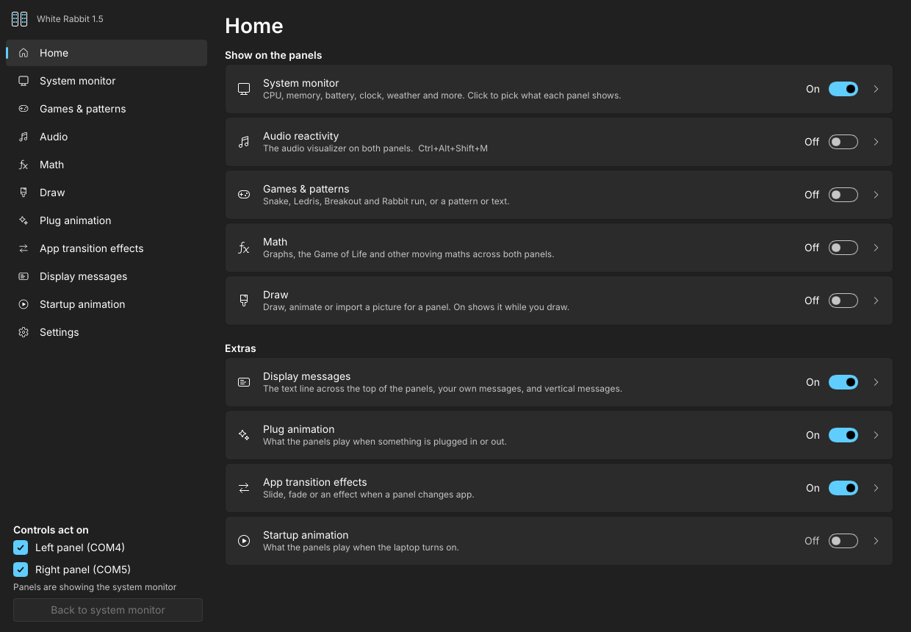

- **Audio reactivity** at the top: turn the music visualizer on for the LED
  panels and the keyboard separately, each with its own sound source.
- **Your hardware:** the LED panels, keyboard and macropad or numpad found,
  numbered in the order they were found, on a picture of the laptop.
- **A switch for every section** (System monitor, Games & patterns, Math, Draw,
  Display messages, Plug animation, App transition effects, Startup animation).
  System monitor, Audio reactivity, Games and Math take over the panels, so
  turning one on turns the others off.
- Pages only show for hardware that is there: no LED panels hides the LED
  Matrix pages, no keyboard hides the keyboard pages.

### System monitor page

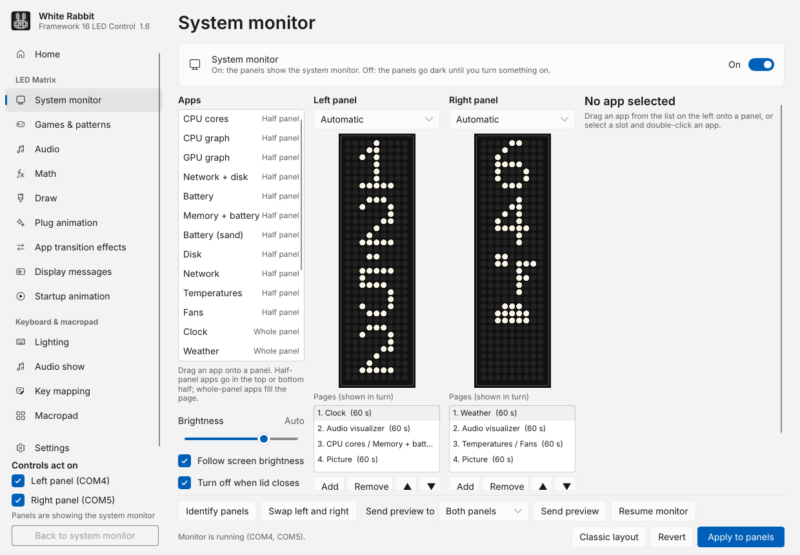

- **Layout editor** with a live preview: put apps on the left and right panel,
  top or bottom half, and set up several pages that take turns.
- **Half-panel apps:** CPU cores (with an afterglow where each core's load just
  was), CPU graph with a RAM meter, GPU graph with a GPU memory meter (pick the
  graphics card), Network + disk with a drive-space meter, Battery (six looks:
  bolt, sweep, bubbles, pour, wave, orbit; flashes when nearly empty), battery
  as a pile of sand, memory + battery, disk, network, temperatures, fans, FPS
  number.
- **Whole-panel apps:** clock, weather, audio visualizer, now playing (album
  cover and song name across both panels), FPS counter for games, picture (your
  drawings or built-in patterns), text, and animations (fire, plasma, DNA helix,
  snowfall, chevrons, bouncing ball).
- **Text app:** your own words, with `{time}`, `{battery}` and `{cpu}` filled in
  live. Three styles: ticker, sideways and stacked.
- Brightness follows the laptop screen, or set it yourself.
- The panels turn off when the lid closes, the screen turns off, the laptop
  sleeps, or the laptop's own screen isn't in use (docked with the lid shut, or
  *Second screen only*), like an old TV switching off. Each of these can be
  turned off in the tray menu.
- Keyboard shortcuts (`Ctrl`+`Alt`+`Shift` + `I` / `N` / `F` / `U` / `M`) show
  the app names, skip to the next app, freeze or unfreeze switching, and turn
  audio reactivity on or off. Each one can be turned off under *Settings >
  Keyboard shortcuts*.

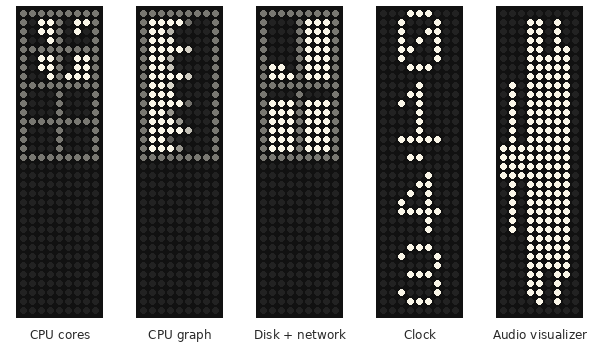

*Some of the monitor apps, drawn by the app's own preview code.*

### Games & patterns page

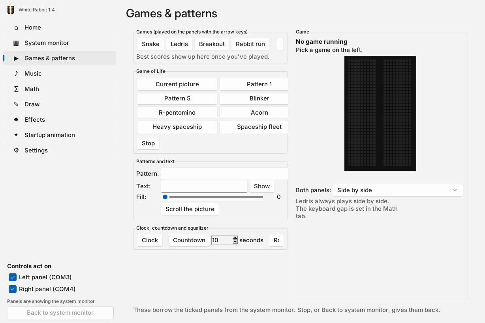

Four games played on the panels: **Snake**, **Ledris**, **Breakout** and
**Rabbit run**. With both panels ticked a game uses them as one 18 x 34 screen.
Arrow keys to play, space to drop or launch, Esc or P to pause; the best score
for each game is kept. Also: Game of Life with 10 extra patterns, the firmware's
built-in patterns, text, a clock, a countdown and a random equalizer.

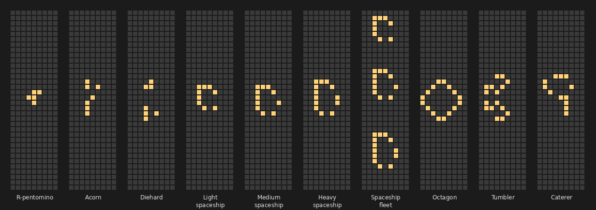

### Audio page

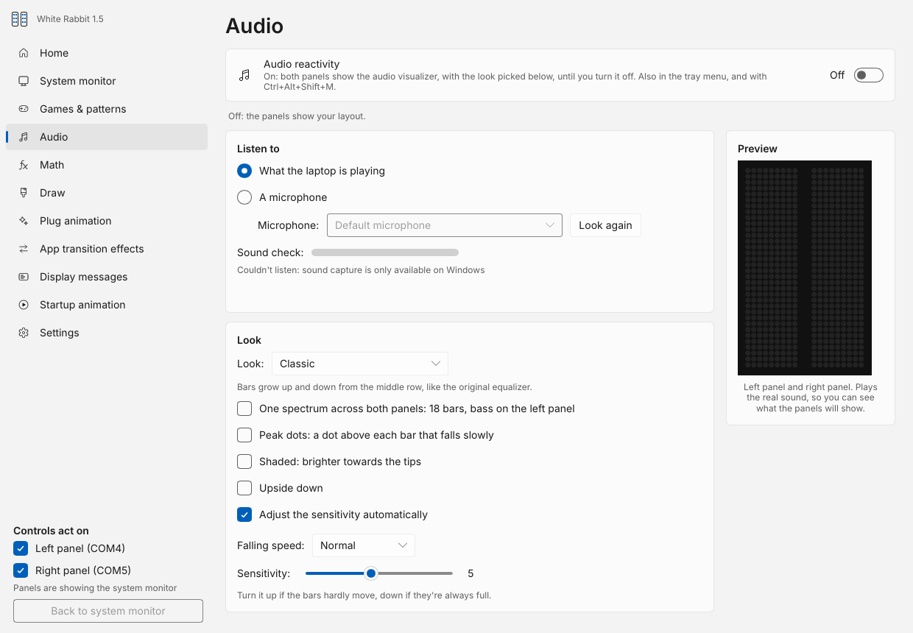

An audio visualizer that moves with what the laptop is playing, or with any
microphone.

- **22 looks:** classic, spectrum analyzer, centre out, dots, spectrogram,
  level meter, waveform, mirror waveform, double waveform, radial bars, radial
  fan, radial facing, rings, pulse, sparkle, bonfire, beat tunnel, fountain,
  lava lamp, heartbeat, dancing rabbit, and water, glow and sparks.
- **Audio reactivity** shows it on both panels until you turn it off (Home, the
  tray menu, or `Ctrl`+`Alt`+`Shift`+`M`). When the music stops it shows a calm
  version of the look, and wakes up when music comes back.
- **Options:** one 18-bar spectrum across both panels, peak dots, shading,
  upside down, falling speed, sensitivity and automatic sensitivity, with a live
  preview and a sound check.

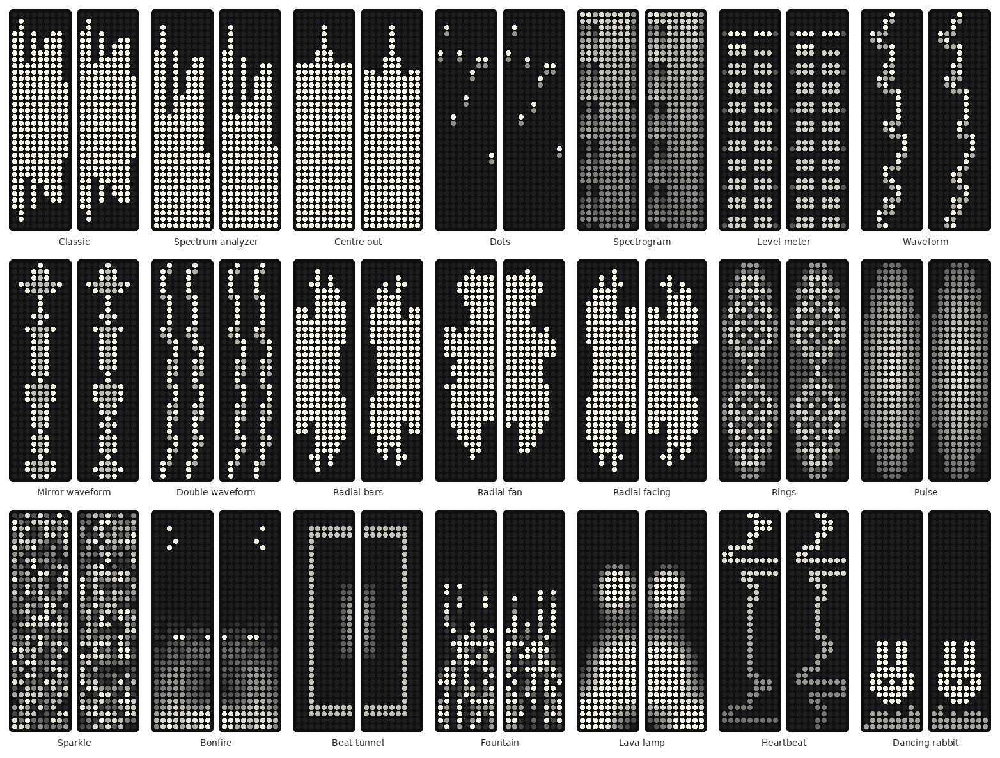

*21 of the looks playing the same moment of music, drawn by the app's own
visualizer code (the water look is newer than this picture).*

### Math page

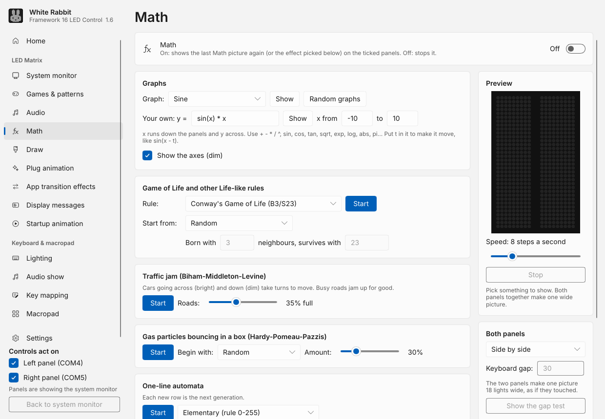

Graphs and simulations in greyscale: 20 ready-made graphs or your own formula
(`sin(x - t)` moves), Game of Life and other Life-like rules, a traffic jam
model, lattice gas particles, one-line automata (Rule 30, Rule 90...), and more
maths (Langton's Ant, Collatz, prime spiral, Lorenz attractor, double pendulum,
sorting, maze solving, Fourier circles, frost, digits of pi and e, Lissajous
curves). Both panels can work as one picture, side by side, skipping the
keyboard gap, or mirrored.

### Draw page

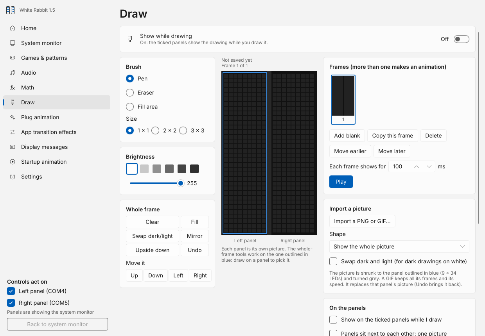

Draw pictures and animations one LED at a time in shades of grey, on one panel
or across both as one picture. Pen, eraser and fill; undo and redo; frames with
their own timing; import a PNG or GIF. Show a drawing on the panels with the
*Picture* app on the System monitor page.

### Plug animation page

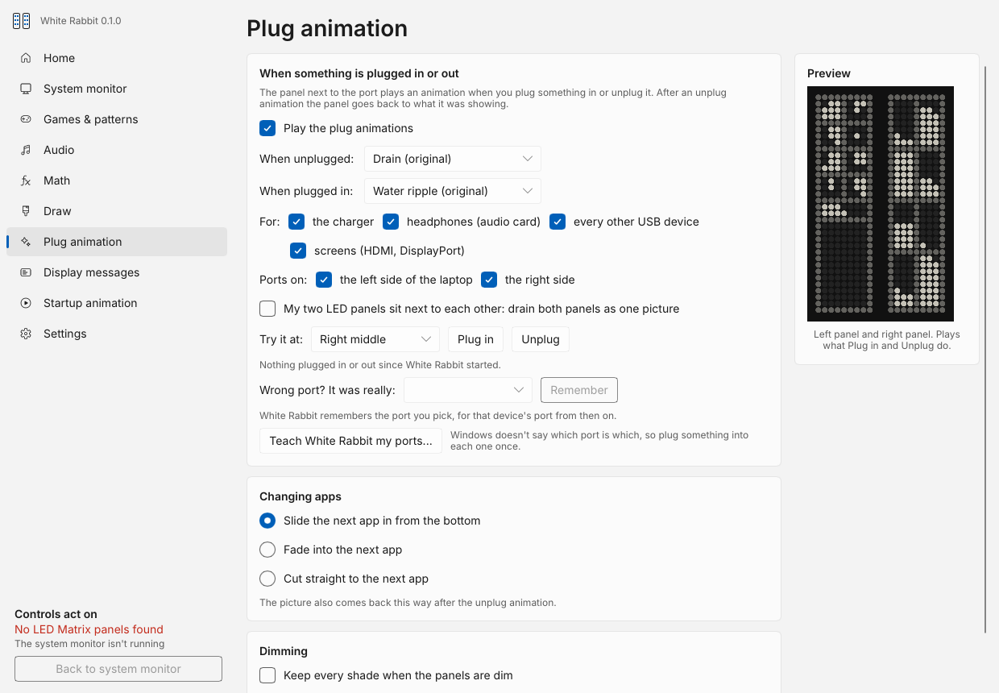

Plug in the charger, headphones, a screen or any USB device and the panel by
that port plays an animation: one for plugging in and one for unplugging
(drain, water ripple, power surge, pixel rain, old TV, ripple ring, glitch).
*Try it* buttons, a way to teach White Rabbit the right port, and switches to
turn the animations off for one side. Also *Keep every shade when dim*, which
dims by LED current instead of pixel value (needs the White Rabbit firmware).

### App transition effects page

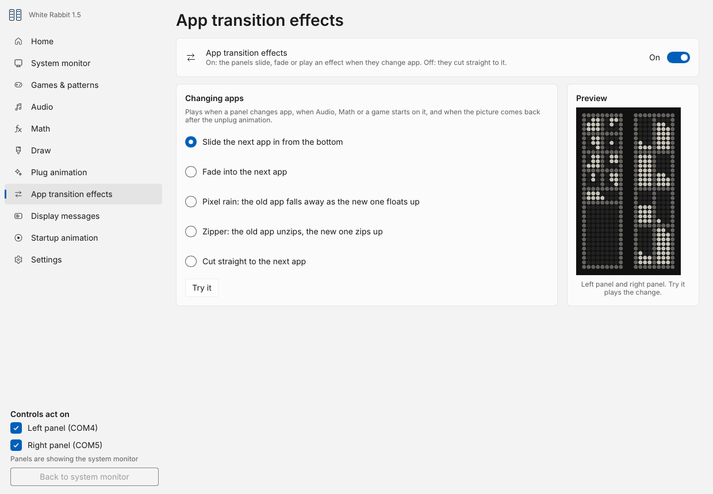

How a panel changes from one app to the next: slide, fade, pixel rain, zipper,
or a straight cut.

### Display messages page

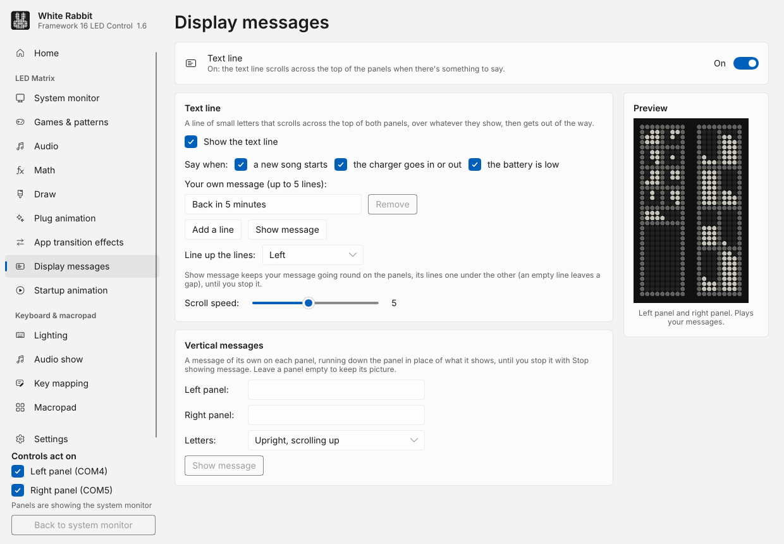

A line of small letters across the top of both panels when a song starts, the
charger goes in or out, or the battery is low. Your own messages of up to 5
lines, and a vertical message on each panel.

### Startup animation page

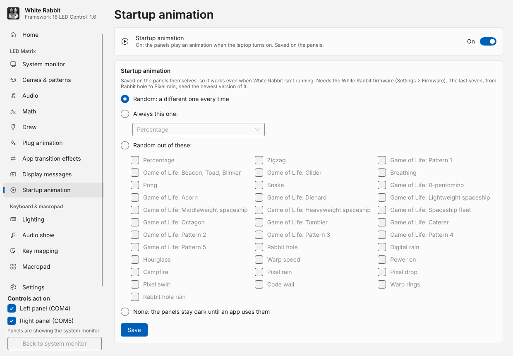

Pick the animation the panels play when the laptop turns on: one, a random one
from a set you choose, a random one from all of them, or none. It is saved on
the panel itself, so it works without the app. Needs the White Rabbit firmware.

### Keyboard & macropad pages

These pages show up when a Framework 16 RGB keyboard or RGB macropad is plugged
in. They need the `f16custom` keyboard firmware, which the Firmware page can
install.

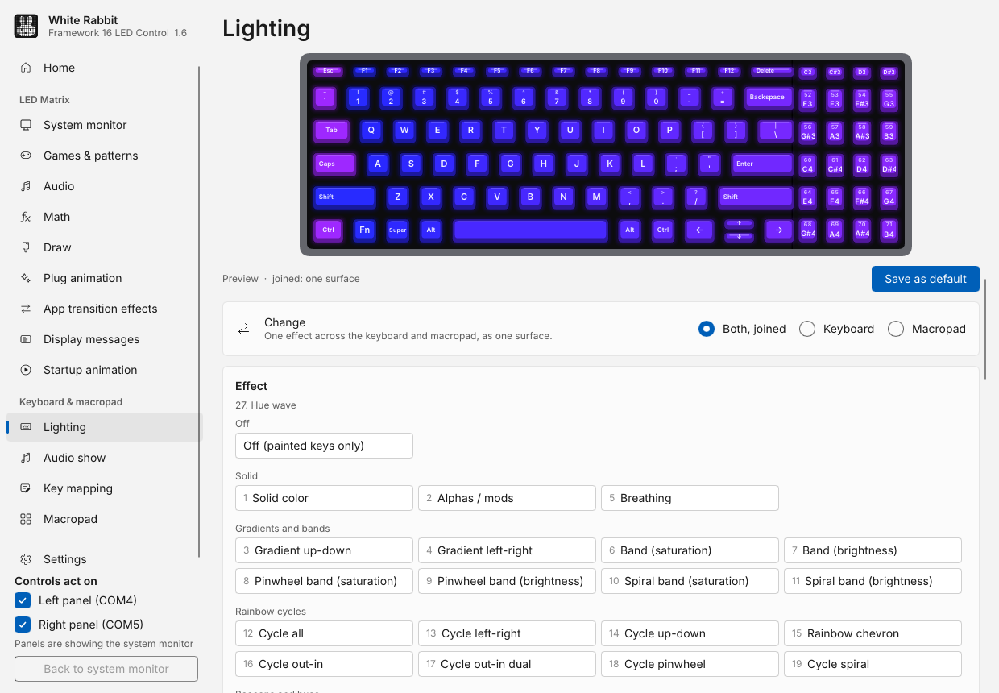

- **Lighting:** the 44 built-in effects, effects drawn by the app across the
  keyboard and macropad as one surface, colours, speed and brightness, and
  painted keys. Clear or black keys are remembered for each keyboard.
- **Audio show:** the keys follow the music (`Ctrl`+`Alt`+`Shift`+`M`, or
  `F12` + `↑`), from what the laptop plays or a microphone.
- **Key mapping:** click a key to change what it sends, turn it off, or make it
  open an app (or White Rabbit). Changes are saved on the keyboard and work on
  any computer. The **Top row** setting picks shortcuts or F1 to F12.
- **Macropad:** its two layers (MIDI notes or numpad) and corner combos.
- The audio show, app-drawn effects and *Open an app* keys keep working with the
  window closed.

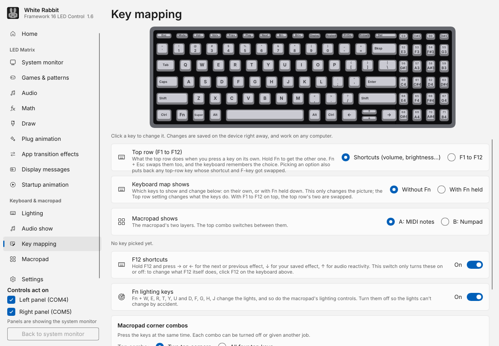

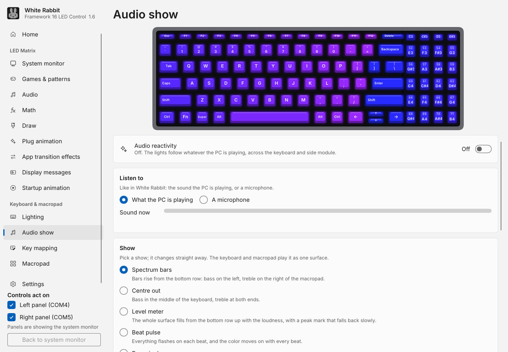

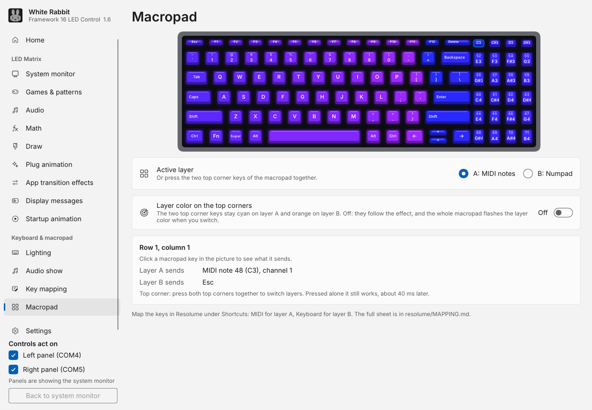

### Settings

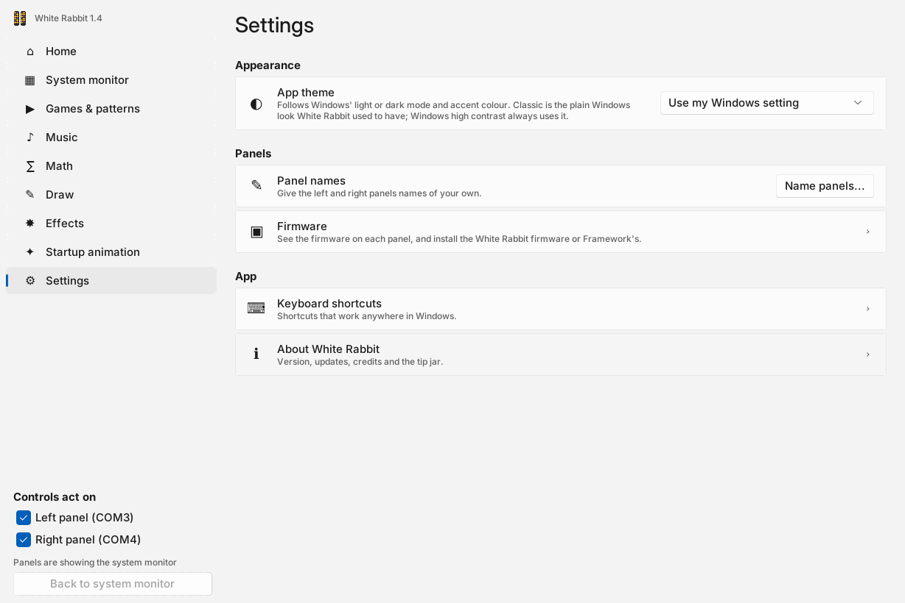

- **App theme:** follow Windows, light, dark, or *Classic*.
- **Panels:** what each panel is doing, panel names, Identify panels.
- **Check for updates:** looks for a newer White Rabbit and newer firmware,
  only when you click it. White Rabbit never checks by itself. It can download
  and run the new installer, and update panels running an older White Rabbit
  firmware build. Framework's official firmware is left alone.
- **Firmware:** which firmware each panel, keyboard and macropad has (with build
  numbers), bootloader mode, and flashing White Rabbit's firmware, Framework's
  official 0.2.0, or any `.uf2` file.
- **Keyboard shortcuts:** turn each of the monitor's shortcuts on or off.
- **About White Rabbit:** version, credits and the tip jar.

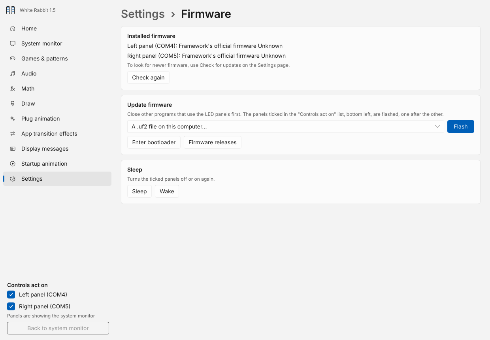

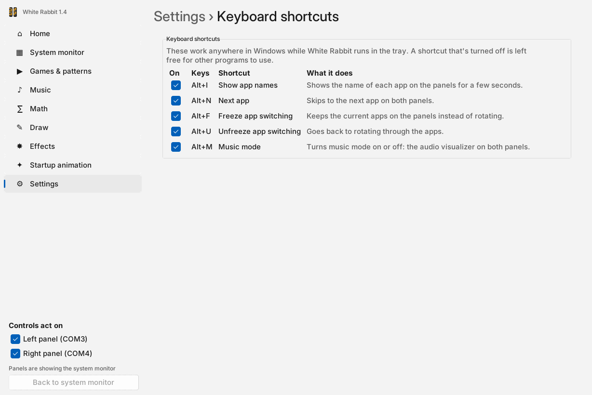

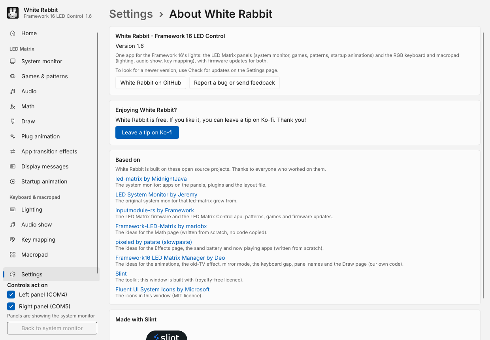

*Screenshots of White Rabbit drawn by the window itself on Linux, with pretend
LED panels and a pretend keyboard and macropad. The font is different from
Windows, and a few pages say they can't reach the panels or the microphone
because there are none.*

## Install and use

1. Download [`WhiteRabbit-setup.exe`](https://github.com/kingof9x/white-rabbit-framework-matrix/releases/latest/download/WhiteRabbit-setup.exe)
   and run it (or unzip `WhiteRabbit-portable.zip` and run `WhiteRabbit.exe`). If
   Windows shows *"Windows protected your PC"*, click *More info* > *Run anyway*
   (the app isn't code-signed yet).
2. Quit the old apps first if you use them: led_mon, `ledmatrixgui.exe` and
   Framework 16 Keyboard Control. They would be holding the panels or the
   keyboard.
3. The panels show the system monitor, an icon appears in the tray, and the
   window opens. Open it again from the Start menu or *Open White Rabbit...* in
   the tray menu. To keep the tray icon out of the hidden-icons arrow, turn on
   *White Rabbit* in *Settings > Personalization > Taskbar > Other system tray
   icons* (Windows 11).
4. **Coming from led_mon or Keyboard Control?** Your layout, brightness,
   weather key and keyboard settings are copied the first time White Rabbit
   starts. The old files are left alone.
5. **Firmware (optional):** the startup animation and the extra patterns need
   the White Rabbit LED Matrix firmware. Under *Settings > Firmware*, tick one
   panel, pick *White Rabbit firmware*, click *Flash*, then do the other panel.
   Framework's official 0.2.0 can be flashed back the same way.

Something not working? Right-click the tray icon > *Open log*, or run
`WhiteRabbit.exe --diagnose` in a command prompt to see which panels the app
finds.

## Good to know

- **Temperatures and fans** come from (in this order with *Automatic*)
  [Framework Control](https://github.com/ozturkkl/framework-control) (no admin
  prompt needed), [Libre Hardware Monitor](https://github.com/LibreHardwareMonitor/LibreHardwareMonitor/releases)
  (while it is open and running as admin), or Framework's `framework_tool`
  (only when White Rabbit itself runs as admin). Pick one under the Temperatures
  or Fans app's settings; `--diagnose` lists what each source gives. The old
  Open Hardware Monitor isn't supported: its WinRing0 driver has a known
  security hole and Windows Defender blocks it.
- **FPS counter** uses Intel's [PresentMon](https://github.com/GameTechDev/PresentMon),
  which the installer includes. Windows only lets programs read frame timing
  when the account is in the *Performance Log Users* group. One-time setup in
  *Terminal (Admin)*:
  `Add-LocalGroupMember -SID S-1-5-32-559 -Member "$env:USERDOMAIN\$env:USERNAME"`,
  then sign out and back in. It counts frames put on screen, so a game's own
  counter can show a different number.
- **Weather** uses Open-Meteo with no key. An OpenWeather key can go in
  `%APPDATA%\WhiteRabbit\.env` (see [`.env-example`](.env-example)).
- **What goes on the internet:** the weather (only while the weather app is in
  your layout), *Check for updates* and downloads (only when you click). There
  is no telemetry. Details are in [docs/ARCHITECTURE.md](docs/ARCHITECTURE.md#network-use).
- **Where things live:** settings, layout, keyboard settings and drawings in
  `%APPDATA%\WhiteRabbit`; logs in `%LOCALAPPDATA%\WhiteRabbit`
  (`WhiteRabbit-monitor.log` and `WhiteRabbit-window.log`).
- **Command line:** `WhiteRabbit.exe --background` starts only the monitor and
  tray icon (that's what runs at sign-in); `--window` only the window;
  `--window --tab firmware` opens it on a page; `--diagnose` prints what the app
  finds.

## For reviewers and developers

- **[docs/ARCHITECTURE.md](docs/ARCHITECTURE.md)** explains how the app is put
  together: the two programs, how they share the panels and the keyboard, how a
  frame is drawn, the files on disk, network use, testing and known limits.
- **[REVIEW.md](REVIEW.md)** has the code review findings, the fixes, the stress
  test results and the memory measurements.

### What's in this repository

| Folder | What it is |
|---|---|
| [`rust/`](rust) | **The app.** A Cargo workspace: `wr-core`, `wr-panel`, `wr-music`, `wr-keyboard`, `wr-monitor` (`WhiteRabbit.exe`) and `wr-window` (`WhiteRabbitWindow.exe`). See [rust/README.md](rust/README.md). |
| [`installer/`](installer) | The Inno Setup script for `WhiteRabbit-setup.exe`. |
| [`.github/workflows/`](.github/workflows) | CI: Rust tests on Windows and Linux, the Windows build with smoke tests, test builds for every pull request, releases and the virus scan. |
| [`docs/`](docs) | The [website](https://kingof9x.github.io/white-rabbit-framework-matrix/), the screenshots and ARCHITECTURE.md. |
| `led_mon/`, `white_rabbit/`, `inputmodule/`, `main.py` | **The older Python version, not shipped.** Kept as the reference the Rust drawing code is tested against, and still runs on Linux in a console. |
| [`tests/`](tests), [`scripts/`](scripts) | Python tests, and the scripts that save the "golden" pictures in `tests/golden/` that the Rust tests must match pixel for pixel. |
| [`res/`](res) | Icons and the logo. |

### Build and test

With [Rust](https://rustup.rs) installed (the version is pinned in
`rust/rust-toolchain.toml`):

```powershell
git clone https://github.com/kingof9x/white-rabbit-framework-matrix
cd white-rabbit-framework-matrix\rust
cargo test                                         # more than 320 tests, including every picture against the golden frames
cargo build --release -p wr-monitor -p wr-window   # rust\target\release\WhiteRabbit.exe and WhiteRabbitWindow.exe
```

The installer, the bundled firmware and PresentMon are put together by
[`.github/workflows/windows.yml`](.github/workflows/windows.yml). Every pull
request gets a test build with download links.

The Python tests: Python 3.12, `pip install -r requirements.txt pytest`, then
`python -m pytest`.

### Screenshots

The screenshots are drawn by the real window without a screen:

```bash
cd rust && cargo build -p wr-window
WHITE_RABBIT_FAKE_PANELS=COM4,COM5 WHITE_RABBIT_FAKE_KEYBOARD=1 \
  target/debug/WhiteRabbitWindow --shoot out.png home 1 1240 860
```

The page names are the keys in `rust/wr-window/ui/app.slint` (`home`, `monitor`,
`games`, `music`, `math`, `draw`, `effects`, `transitions`, `messages`,
`startup`, `lighting`, `kbaudio`, `keys`, `macropad`, `settings`, `firmware`,
`shortcuts`, `about`). `WHITE_RABBIT_APPEARANCE=dark` gives dark mode.

### Firmware

The LED Matrix firmware is built in
[kingof9x/inputmodule-rs](https://github.com/kingof9x/inputmodule-rs), based on
Framework's official 0.2.0; each White Rabbit build bundles its newest release.
The keyboard and macropad firmware (`f16custom`, QMK) is built in
[kingof9x/framework-16-keyboard-customization](https://github.com/kingof9x/framework-16-keyboard-customization).

### Virus scan

After a release, *Actions > Virus scan > Run workflow* uploads the installer
and the exes to [VirusTotal](https://www.virustotal.com) and puts the results
near the top of this README. It needs the repository secret
`VIRUSTOTAL_API_KEY`.

## Where it comes from

White Rabbit is built on these projects (see [LICENSE](LICENSE) and
[LICENSES/](LICENSES)):

- [kingof9x/led-matrix](https://github.com/kingof9x/led-matrix), a Windows
  fork of [MidnightJava/led-matrix](https://github.com/MidnightJava/led-matrix),
  itself based on [LED System Monitor](https://code.karsttech.com/jeremy/FW_LED_System_Monitor.git)
  (MIT). It is the `led_mon` folder here, and the Rust monitor is a port of it.
- [kingof9x/inputmodule-rs](https://github.com/kingof9x/inputmodule-rs), a fork
  of [Framework's inputmodule-rs](https://github.com/FrameworkComputer/inputmodule-rs)
  (MIT). Its Python package is the `inputmodule` folder here; the LED Matrix
  firmware is still built there.
- Callum's [framework-16-keyboard-customization](https://github.com/kingof9x/framework-16-keyboard-customization):
  the keyboard and macropad pages. The app code is MIT here; its keyboard
  firmware stays GPL in that repository.

Ideas only, with no code copied:

- The plug-in ripple, sand battery, now playing app, CPU afterglow, text line,
  sliding between apps, the water look and dimming by LED current were inspired
  by patate's (slowpaste) [pixeled](https://github.com/slowpaste/pixeled).
- Most of the Math page's graphs and simulations come from mariobx's
  [Framework-LED-Matrix](https://github.com/mariobx/Framework-LED-Matrix)
  (GPL-3.0). The Math page is written from scratch from the textbook
  definitions.
- The animations, the old-TV effect, the Draw page, and the mirror, keyboard
  gap and panel name ideas come from Deovandski's
  [Framework16 LED Matrix Manager](https://github.com/Deovandski/Deo-s-Framework16-LED-Matrix-Manager)
  (MIT).

The window is made with [Slint](https://slint.dev) (royalty-free licence), its
icons are Microsoft's [Fluent UI System Icons](https://github.com/microsoft/fluentui-system-icons)
(MIT), and the FPS counter runs Intel's [PresentMon](https://github.com/GameTechDev/PresentMon)
(MIT). White Rabbit is not made or endorsed by Framework Computer.

Thanks to everyone who worked on those.

## Project status

**Status:** Active  
**Waiting on:** Callum: testing 1.6 on the laptop (keyboard merge, Top row, new monitor halves, Home audio reactivity)  
**Notes:** One tray app for the Framework 16's LED Matrix panels and RGB keyboard and macropad, all in Rust (about 6 MB in memory, down from 66 MB in Python). Not code-signed yet.  
**Last updated:** 2026-11-25
